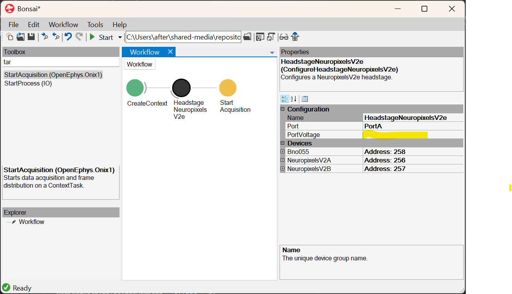

> [!CAUTION]
> Setting `PortVoltage` manually turns off automatic voltage discovery. The value you enter is
> applied to the headstage port as-is. Except for the UCLA Miniscope V4, which rejects values above
> 6.0 V, the library does not check whether a manual value is safe for the connected headstage.
> Too high a voltage can permanently damage a headstage.

> [!WARNING]
> The voltage that reaches the headstage depends on tether length and on how much current the
> headstage draws. A `PortVoltage` that is safe with a long tether can be too high for the same
> headstage on a shorter one. Remove a manual `PortVoltage` (leave the property empty) before you
> switch to a shorter tether or a different headstage. Make sure that everyone who might modify the
> rig knows that a manual `PortVoltage` is in use.

Each ONIX headstage gets power and communicates over a single thin coaxial tether. The tether
supplied with a headstage is 2.5 m long. This tutorial explains what limits tether length and how
to set the port voltage so that a longer tether delivers enough voltage to the headstage.

Before you start, read these two pages in the ONIX hardware guide:

- [Tethers](https://open-ephys.github.io/onix-docs/Hardware%20Guide/Headstages/tethers.html)
- [Tether Voltage](https://open-ephys.github.io/onix-docs/Hardware%20Guide/Headstages/tether-voltage.html)

## What limits tether length

### DC voltage drop

The tether carries the headstage supply current through its center conductor and back through its
shield. The [tether cable](../../images/tutorials/port-voltage/PCX40K10AK.pdf) has the following
nominal DC resistance:

| Path | Resistance |
| --- | --- |
| Center conductor | 5.53 Ω/m |
| Shield | 4.75 Ω/m |
| Round trip | ≈ 10.3 Ω/m |

Every 10 mA of headstage current therefore drops about 0.1 V per meter of tether. A longer tether
needs a higher port voltage to deliver the same voltage at the headstage. This is what the manual
`PortVoltage` setting compensates for.

### Signal attenuation

The serializer that sends data from the headstage to the breakout board is rated for cables up to
15 m. That rating assumes much thicker cable than an ONIX tether, which loses considerably more
signal per meter at the frequencies the serializer uses, so do not expect a link to work at 15 m.

In practice, labs regularly use 5 m tethers, and a 4 m tether was used in the [ONIX paper](https://doi.org/10.1038/s41592-024-02521-1).

## Automatic port voltage

When `PortVoltage` is empty, the headstage's configuration operator searches for the lowest port
voltage at which the link locks, then adds an offset to provide margin. The search range and offset
are specific to each headstage:

| Headstage | Search range (V) | Offset after lock (V) | Highest automatic voltage (V) |
| --- | --- | --- | --- |
| Neuropixels 1.0e | 3.3–5.5 | 1.0 | 6.5 |
| Neuropixels 1.0f | 5.0–7.0 | 1.0 | 8.0 |
| Neuropixels 2.0e | 3.3–5.5 | 1.0 | 6.5 |
| Neuropixels 2.0e (beta) | 3.3–5.5 | 1.0 | 6.5 |
| Neuropixels 2.0 + RHD2000e | 4.0–6.0 | 0.8 | 6.8 |
| NRIC1384 | 3.8–5.5 | 0.7 | 6.2 |
| Rhs2116 | 3.3–4.4 | 2.0 | 6.4 |
| Headstage 64 | 3.3–6.5 | Scaled; targets 5.0–5.3 V at the headstage | — |
| UCLA Miniscope V4 | No automatic search; defaults to 5.5 | — | Manual values above 6.0 are rejected |

If the search finds no lock within its range, the workflow fails to start and the error message
tells you the highest voltage it tried. With a long tether, this usually means the voltage drop is
larger than the search range can make up for.

## Setting the port voltage manually

1. Try automatic mode first. Leave `PortVoltage` empty, connect the long tether, and start the
   workflow. After the workflow starts, the `PortVoltage` property shows the applied value followed
   by `(Auto)`.

1. Check the link and the voltage at the headstage. The link is locked when the port's LED on the
   breakout board is purple. Measure the DC voltage at the headstage as described on the
   [Tether Voltage](https://open-ephys.github.io/onix-docs/Hardware%20Guide/Headstages/tether-voltage.html)
   page. If the link is stable and the voltage is within the headstage's required range, you are
   done.

1. Otherwise, stop the workflow, select the headstage's configuration operator, and enter a
   value in its `PortVoltage` property:

    

    Start from the automatically applied value from step 1, or from the highest automatic voltage
    in the table above if automatic mode failed.

1. Restart the workflow and measure the voltage at the headstage again.

1. Increase `PortVoltage` in 0.2 V steps, measuring after each change, until the voltage at the
   headstage is within the required range and the link is stable. The port voltage is set with
   0.1 V resolution; extra decimal places are truncated.

1. Write down the final value together with the tether length. Use that value only with that
   tether and that headstage.
